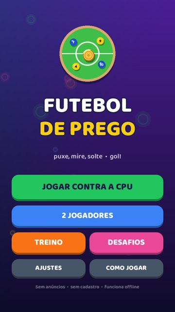
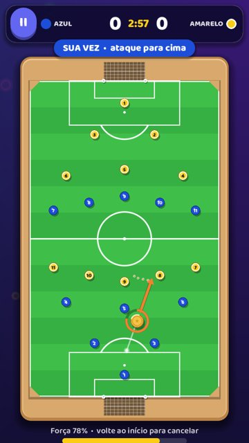
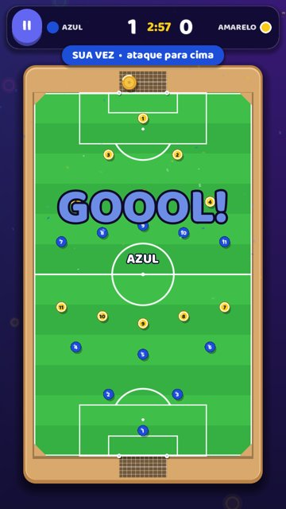
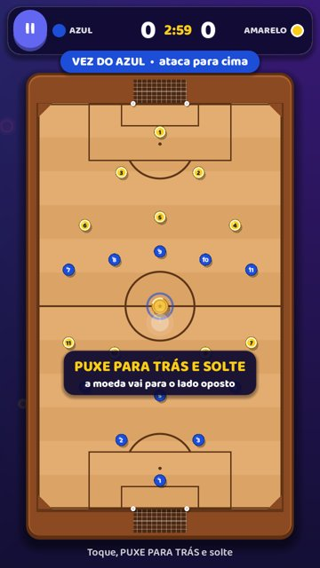
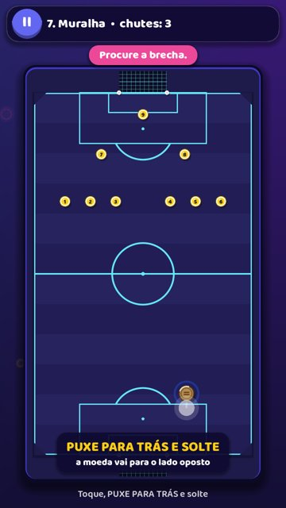
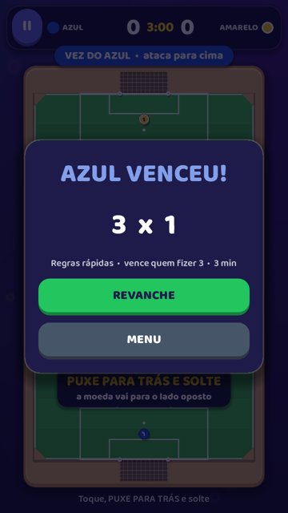

# Futebol de Prego ⚽📌

Futebol de prego de bolso para Android: **puxe, mire, solte, gol!**
Campo vertical, gol em cima e embaixo, chute de estilingue (o dedo puxa para trás, a moeda vai para o lado oposto), pregos numerados de 1 a 11 como nos tabuleiros de madeira.

| Menu | Mira | Gol | Madeira | Desafio | Resultado |
|---|---|---|---|---|---|
|  |  |  |  |  |  |

## Baixar o APK de teste
Cada push na `main` roda os testes e gera um APK em **Releases → "APK de teste (mais recente)"**.
Transfira para o celular e instale (é preciso permitir "instalar apps de fontes desconhecidas").
O APK é assinado com chave de depuração: serve para testar, não para a Play Store.

## Modos
- **Contra a CPU**: iniciante, médio e avançado. A CPU testa chutes com a mesma física do jogo e erra como gente (ruído de mira e força).
- **2 jogadores** no mesmo celular, alternando.
- **Treino**: sem placar, botões para posicionar a moeda (centro, pênalti, lateral).
- **Desafios**: 8 fases de precisão com estrelas e desbloqueio progressivo.

## Rodar e exportar
1. Instale o [Godot 4.3](https://godotengine.org/download/archive/4.3-stable/) (versão padrão, não a .NET).
2. Abra o Godot → *Importar* → selecione `project.godot` → *Executar* (F5).
3. Android: *Editor → Gerenciar modelos de exportação* → baixar; em *Configurações do editor → Exportar → Android* informe o SDK Android e o JDK 17;
   *Projeto → Exportar → Android → Exportar projeto*.
4. Para a Play Store, gere uma chave própria (`keytool`) e um AAB (exige *Gradle build*).

Testes: `godot --headless --path . --fixed-fps 60 --script res://tests/run_tests.gd`
Capturas: `xvfb-run godot --path . --rendering-driver opengl3 --resolution 720x1280 --script res://tests/screenshots.gd -- <pasta>`

## Estrutura
```
scripts/core/    física (coin_sim), campo/formações/desafios (field_data), IA (ai_player)
scripts/game/    tabuleiro e gesto (board), regras/HUD (match_screen), tutorial (coach)
scripts/ui/      menu, configuração da partida, desafios, ajustes, ajuda, kit visual
scripts/autoload save (salvamento local), sfx (sons sintetizados)
tests/           testes automatizados e gerador de capturas
docs/            decisões de design e resultados dos testes
```

Fonte Baloo 2 (SIL Open Font License, `assets/fonts/OFL.txt`). Toda a arte é desenhada em código; sons são sintetizados. Sem anúncios, sem apostas, sem cadastro, sem internet.
